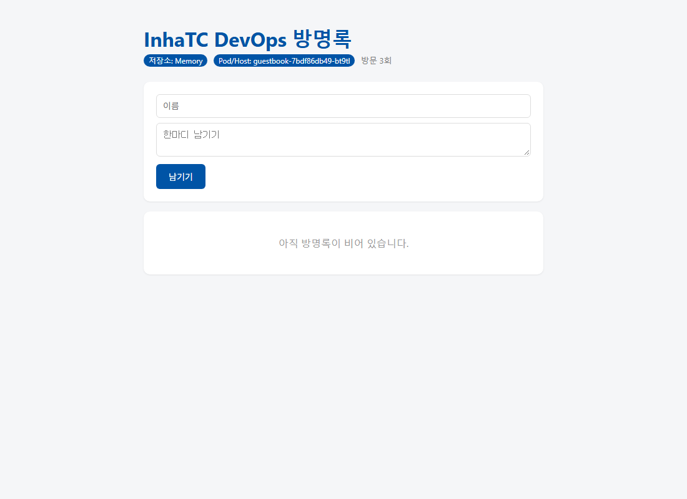

# week09 — 쿠버네티스 첫 배포

- 환경: Windows 11 + WSL2 (Ubuntu 24.04), Docker Engine 29.1.3
- 사용한 도구: **minikube v1.39.0** (`--driver=docker`), kubectl v1.37.1
- 전체 실행 로그: [logs/](logs/)

## 1. kubectl get nodes (Ready)

```
$ kubectl get nodes
NAME       STATUS   ROLES           AGE   VERSION
minikube   Ready    control-plane   27s   v1.37.0

$ docker ps --format "{{.Names}}  {{.Image}}"
minikube  gcr.io/k8s-minikube/kicbase:v0.0.51     # 이 컨테이너가 곧 노드
```

## 1-1. 클러스터 탐색 · 네임스페이스 · 컨텍스트

```
$ kubectl get namespaces
NAME              STATUS   AGE
default           Active   28m
kube-node-lease   Active   28m
kube-public       Active   28m
kube-system       Active   28m

$ kubectl get pods -n kube-system        # 쿠버네티스 자신도 Pod로 돈다
etcd-minikube                      1/1   Running
kube-apiserver-minikube            1/1   Running
kube-controller-manager-minikube   1/1   Running
kube-scheduler-minikube            1/1   Running
...

$ kubectl config get-contexts
CURRENT   NAME       CLUSTER    AUTHINFO   NAMESPACE
*         minikube   minikube   minikube   default
```

## 1-2. 첫 Pod (`kubectl run`)

```
$ kubectl run mynginx --image=nginx
pod/mynginx created
$ kubectl describe pod mynginx       # Events: Scheduled → Pulling → Pulled → Created → Started
$ kubectl logs mynginx
$ kubectl exec -it mynginx -- bash   # cat /etc/os-release, ls /usr/share/nginx/html/index.html
$ kubectl port-forward mynginx 8081:80   # 8080은 방명록이 사용 중이라 8081 사용
```

## 2. 자가 치유 — Pod를 지운 뒤 새 Pod가 태어남 (`kubectl get pods -w`)

`kubectl run`으로 만든 Pod는 지우면 그대로 사라짐(`No resources found`).
Deployment(`--replicas=3`)의 Pod는 지우자마자 새 Pod가 생성됨.

```
$ kubectl delete pod mynginx-668c4f948b-hfvh9

$ kubectl get pods -w
NAME                       READY   STATUS              RESTARTS   AGE
mynginx-668c4f948b-hfvh9   1/1     Running             0          5s
mynginx-668c4f948b-p687q   1/1     Running             0          5s
mynginx-668c4f948b-q76pv   1/1     Running             0          5s
mynginx-668c4f948b-hfvh9   1/1     Terminating         0          7s
mynginx-668c4f948b-s7ffs   0/1     Pending             0          0s
mynginx-668c4f948b-s7ffs   0/1     ContainerCreating   0          0s
mynginx-668c4f948b-s7ffs   1/1     Running             0          2s   ← 새로 태어난 Pod (이름 끝이 다름)
```

`kubectl delete pods --all` 후에도 다시 3/3으로 복구됨.

## 3. 내 방명록을 쿠버네티스에서 실행

```
$ minikube image load ghcr.io/bin5537/guestbook:v1
$ kubectl create deployment guestbook --image=ghcr.io/bin5537/guestbook:v1
$ kubectl get pods
NAME                         READY   STATUS    RESTARTS   AGE
guestbook-7bdf86db49-bt9tl   1/1     Running   0          0s
$ kubectl port-forward deployment/guestbook 8080:5000
```

- 제목: InhaTC DevOps 방명록 / 저장소: Memory / **Pod/Host: guestbook-7bdf86db49-bt9tl**
- Pod 삭제 → 새 Pod 생성, 그러나 기존 port-forward는 끊김 → 다시 실행해야 접속됨 (logs/03_guestbook.txt)



## 4. 선언형을 내 언어로

"어떻게 하라"가 아니라 "이 상태여야 한다"만 정해두면 시스템이 계속 확인하며 맞춰 주는 방식 — 에어컨에 26도만 설정해 두면 알아서 켜고 끄는 것과 같다.

## 5. 막혔던 것과 해결

- **ghcr 이미지 pull 실패 (unauthorized)**: ghcr 패키지가 비공개/미존재 상태라 받을 수 없었음.
  week07 guestbook 소스로 빌드한 이미지에 `ghcr.io/bin5537/guestbook:v1` 태그를 붙이고
  `minikube image load` 로 노드에 복사 → 태그가 `latest`가 아니라서 `IfNotPresent`로 동작해 바로 실행됨.
- **`kubectl: command not found`**: MSYS2(UCRT64) 터미널에서 실행했기 때문. `wsl -d Ubuntu-24.04`로 들어가서 실행하니 해결.
- **`unknown command "pods"`**: `k pods`처럼 동사(get)를 빠뜨림 → `k get pods -n kube-system`. kubectl은 `동사 → 종류 → 이름 → 옵션` 순서.
- **`Error from server (NotFound)`**: `myngnix` 오타 → `mynginx`로 정확히 입력.
- **exec 안에서 `cat`만 입력해 멈춤**: 파일 없이 `cat`을 실행하면 입력을 기다림 → Ctrl+C 후 `cat /etc/os-release`.
- **localhost:8081 `ERR_CONNECTION_REFUSED`**: port-forward를 Ctrl+C로 끈 뒤 접속함. port-forward는 실행 중일 때만 연결되므로 켜 둔 상태에서 접속.
- **Pod 삭제 후 localhost:8080 접속 안 됨**: port-forward는 지워진 Pod에 묶여 있었기 때문. 다시 실행하면 해결 (근본 해결은 다음 시간의 Service).
